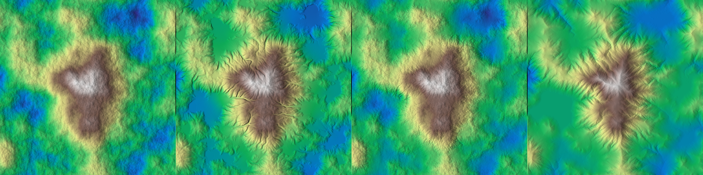

# Hydraulic Erosion Models Comparison

This document provides a comparative analysis of the three primary hydraulic erosion approaches implemented in HighMap:
- **`hydraulic_particle`**: Lagrangian discrete droplet simulation.
- **`hydraulic_stream_log`**: Eulerian $D_\infty$ logarithmic stream power incision.
- **`hydraulic_mise`**: Multiscale Implicit Stream-power Erosion with coupled sediment dynamics.

The visualization and benchmarks below are produced by [`ex_hydraulic_comparison.cpp`](file:///home/glop/Documents/dev/HighMap/examples/ex_hydraulic_comparison/ex_hydraulic_comparison.cpp).

## 1. Visual Comparison

The following banner shows the original un-eroded conical terrain alongside the result of each solver applied to the same input heightfield:

*Left to right: (1) Original un-eroded terrain, (2) `hydraulic_particle`, (3) `hydraulic_stream_log`, (4) `hydraulic_mise`.*

### Erosion Difference Maps
The net erosion maps ($z_{\text{before}} - z \ge 0$) highlight the spatial distribution and channelization patterns of each model:

.")

*Left to right: (1) `hydraulic_particle` erosion delta, (2) `hydraulic_stream_log` erosion delta, (3) `hydraulic_mise` erosion delta.*

## 2. Qualitative Characteristics

| Feature | `hydraulic_particle` | `hydraulic_stream_log` | `hydraulic_mise` |
| :--- | :--- | :--- | :--- |
| **Model Type** | Lagrangian (discrete droplets) | Eulerian (raster flow accumulation) | Topological drainage graph & implicit PDE |
| **Primary Kinematics** | Droplet advection, velocity, inertia | $D_\infty$ continuous facet routing | Priority flood, receiver graph routing |
| **Discharge Scaling** | Droplet volume & kinetic energy | Logarithmic discharge $\log_{10}(A)$ | Power-law area $A^m$ |
| **Deposition Mechanism** | Bilinear capacity drop & talus bank collapse | Synthetic hole filling & gradient blending | Equilibrium slope $S_{\text{eq}}(A)$ & lake filling |
| **Visual Structure** | Deep meandering rills, braided gullies | Broad dendritic river corridors | Geologically realistic valleys, alluvial plains, scarp retreat |
| **Execution Engine** | GPU (OpenCL) | GPU (OpenCL) & OpenMP | Multi-threaded CPU (OpenMP) |
| **Artifact Vulnerability** | Droplet streaks if iteration count is low | Minor contour alignment if un-warped | None (domain-warped multiscale scheduling) |

## 3. Algorithm Deep Dives

For exhaustive equations, trajectory kinematics, and C++ API signatures:
- [Hydraulic Particle Erosion](hydraulic_particle.md)
- [Hydraulic Stream Log Erosion](hydraulic_stream_log.md)
- [Multiscale Implicit Stream-Power Erosion (MISE)](hydraulic_mise.md)
