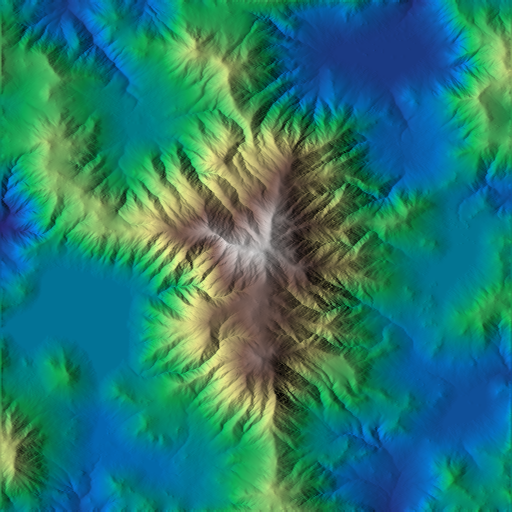
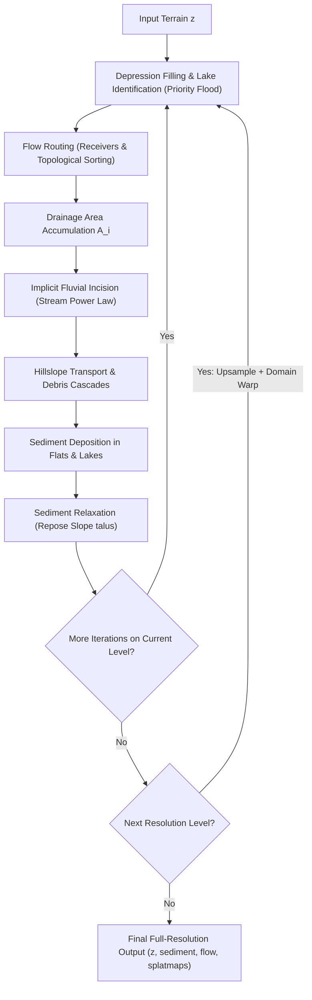
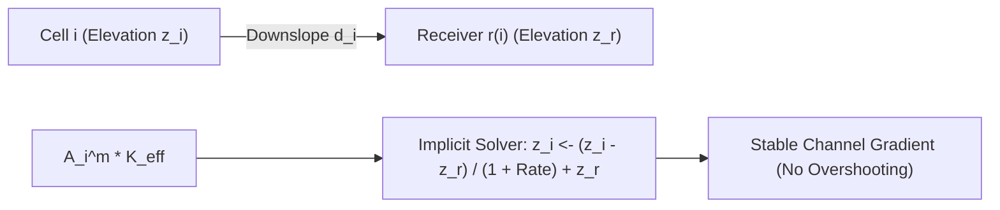
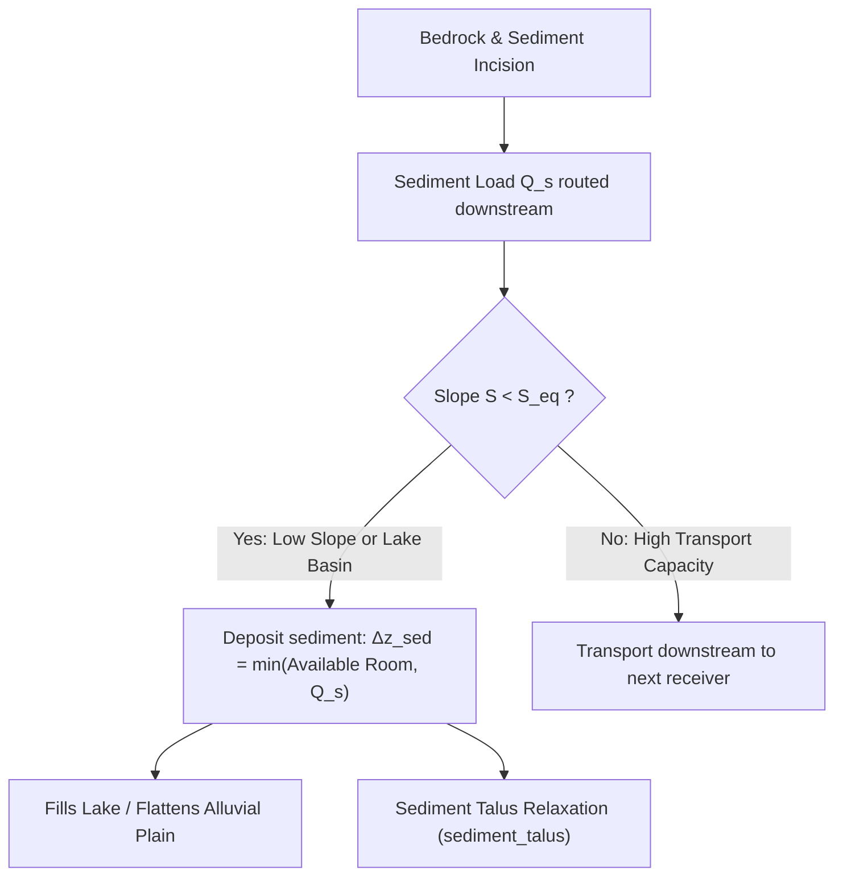
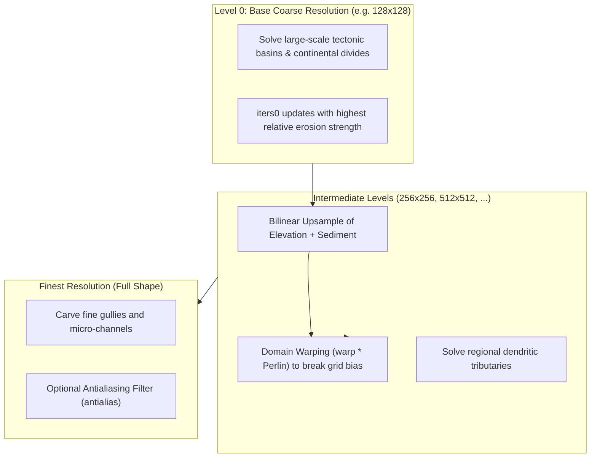

# Multiscale Implicit Stream-Power Erosion (MISE)

This document details the theory, geomorphological formulations, implicit solver, and multiscale architecture of `hydraulic_mise` in HighMap.

## 1. Overview

`hydraulic_mise` (Multiscale Implicit Stream-power Erosion) simulates long-term landscape evolution by solving coupled equations of fluvial bedrock incision, hillslope diffusion/debris flow, and alluvial sediment deposition across a dynamically re-routed drainage graph.



Unlike explicit particle tracing or simple height filtering, MISE uses:
- **Implicit integration**: Unconditionally stable large time steps without numerical blow-up.
- **Topological drainage graphs**: Built using monotone priority-queue depression filling (Radix heap / bucket flood).
- **Coupled sediment conservation**: Eroded material is carried downstream as bedload and suspended sediment until equilibrium deposition conditions are met.
- **Pyramidal multiscale scheduling**: Macro-valleys are carved at coarse base resolutions and refined down to fine rills with domain-warped upsampling.



## 2. Theoretical Formulation and Kinematics

### Drainage Graph and Depression Filling
Surface flow routes downhill from donors to receivers. To resolve local depressions (pits, sinks, and closed lakes), the terrain is processed with a priority flood algorithm:

1. A boundary queue seeds the flood, tracking minimum spill elevation.
2. Pits are identified and tagged (`lake`), grouping flooded basins and their associated spillway outlets (`lake_outlet`).
3. Flow directions assign each non-outlet cell $i$ to a downslope receiver cell $r(i)$:

$$P(i \to j) \propto \max\left(0, \frac{z_i - z_j}{d_{ij}}\right)^{\gamma}$$

where $\gamma = \text{receiver\_exp}$ and $d_{ij} \in \{1, \sqrt{2}\}$ is grid neighbor distance.

4. The graph produces a strict topological order (receivers ordered before donors), enabling $O(N)$ linear-time sweeps across the terrain.

### Fluvial Stream-Power Incision
Fluvial bedrock erosion is governed by the stream power incision law:

$$\frac{\partial z}{\partial t} = -K A^m S^n$$

where $A$ is upstream drainage area, $S = -\frac{\partial z}{\partial x}$ is local channel slope, and $K$ is erodibility.

In MISE, the equation is solved **implicitly** along each flow line $i \to r(i)$:

$$z_i^{t+1} - z_{r(i)}^{t+1} = \frac{z_i^t - z_{r(i)}^{t+1}}{1 + K_{\text{eff}} A_i^m \frac{\Delta t}{d_i}}$$

This implicit formulation ensures that slopes never invert or overshoot, even under large incision rates $K$.



### Hillslope Processes and Debris Flow
Bedrock hillslopes experience two geomorphic diffusion mechanisms:

1. **Talus Relaxation**: Diffuses steep slopes exceeding the critical bedrock angle of repose $\theta_{\text{talus}}$:

$$S_{\text{excess}} = \max\left(0, \frac{z_i - z_{r(i)}}{d_i} - \theta_{\text{talus}}\right)$$

2. **Upstream Debris Loading**: Steep upstream terrain sheds regolith and rock fragments that amplify erosion and scarp recession downstream via the `debris` coefficient:

$$K_{\text{debris}} = \text{debris} \cdot S_{\text{upstream\_excess}}$$

Hard cliff thresholds (`cliff`) prevent unnatural vertical knife-edges along stream channels.

## 3. Sediment Transport and Deposition

As streams erode rock, eroded volume is added to the transported sediment load $Q_s$.



### Equilibrium Slope
Sediment settles when channel slope falls below an equilibrium transport slope $S_{\text{eq}}$, which decays with increasing drainage area:

$$S_{\text{eq}}(A) = \theta_{\text{dep}} \cdot \max\left(0.01, \left(\frac{A}{\text{deposition\_area}}\right)^{-\beta}\right)$$

where $\theta_{\text{dep}} = \text{deposition\_slope}$ and $\beta = \text{deposition\_exp}$.

### Deposition in Depressions and Lakes
When sediment reaches a flooded depression (`lake` basin):
- The `lake_fill` factor determines the fraction of sediment retained inside the basin.
- Sediment deposits horizontally up to the lake spill level, creating flat alluvial valley bottoms and dry lakebeds (playas).
- Excess sediment spills over the outlet into downstream reaches.

### Loose Sediment Geomechanics
Deposited alluvium is mechanically distinct from solid bedrock:
- **Higher Erodibility**: Loose sediment erodes faster than parent bedrock ($K_{\text{sed}} = K \cdot \text{sediment\_erodibility}$).
- **Lower Angle of Repose**: Subaerial loose sediment slumps at a lower repose angle ($\theta_{\text{sed\_talus}} < \theta_{\text{talus}}$), regulated by multi-pass relaxation sweeps (`sediment_relax_iters`).

## 4. Multiscale Architecture and Scheduling

`hydraulic_mise` achieves high computational performance and geomorphological coherence through a dyadic resolution pyramid.



### Multiscale Parameters
- `base_res`: Grid resolution of the coarsest level (default: 128).
- `share_ratio`: Geometric decay factor of erosion strength across levels.
- `iters0`: Number of flow-routing recalculations on the coarsest level.
- `iters_decay`: Rate at which iteration count diminishes as resolution increases.
- `warp`: Amplitude of procedural Perlin coordinate perturbation applied during upsampling to prevent axis-aligned river artifacts.
- `skip_finest`: Allows skipping the most expensive fine-scale passes for rapid preview iterations.

## 5. C++ API Reference

The primary interface resides in [`hydraulic_erosion.hpp`](file:///home/glop/Documents/dev/HighMap/HighMap/include/highmap/erosion/hydraulic_erosion.hpp) and [`erosion_parameters.hpp`](file:///home/glop/Documents/dev/HighMap/HighMap/include/highmap/erosion/erosion_parameters.hpp):

```cpp
#include "highmap.hpp"

// Setup configuration
hmap::MiseParams params;
params.strength            = 0.60f; // Erosion intensity (K * duration)
params.area_exp            = 0.45f; // Drainage area exponent m
params.downcutting         = 1.00f; // Area downcutting cap
params.talus               = 3.20f; // Critical bedrock slope
params.debris              = 200.f; // Hillslope debris multiplier
params.deposition_slope    = 1.80f; // Threshold slope for sediment settling
params.deposition_rate     = 1.00f; // Fill fraction per step
params.sediment_talus      = 1.40f; // Loose sediment repose slope
params.base_res            = 128;   // Base resolution for coarse pass
params.warp                = 0.35f; // Upsampling domain warp
params.seed                = 42;    // Deterministic random seed

hmap::Array sediment;
hmap::Array flow;
hmap::Array erosion_map;
hmap::Array deposition_map;

// In-place hydraulic MISE simulation
hmap::hydraulic_mise(
    z,                     // Target heightfield
    params,                // Solver parameters
    /* p_bedrock */        nullptr,
    /* p_erodibility */    nullptr,
    /* p_moisture_map */   nullptr,
    /* p_outlet */         nullptr,
    /* p_sediment */       &sediment,
    /* p_flow */           &flow,
    /* p_erosion_map */    &erosion_map,
    /* p_deposition_map */ &deposition_map
);
```
