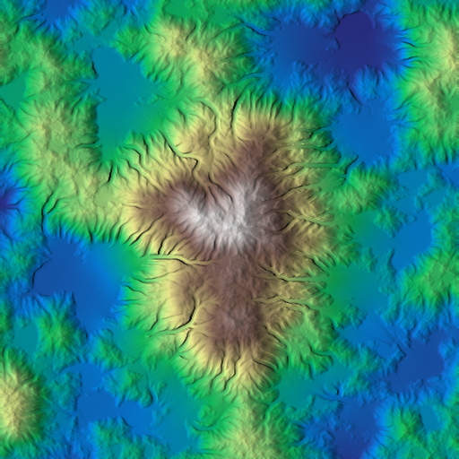
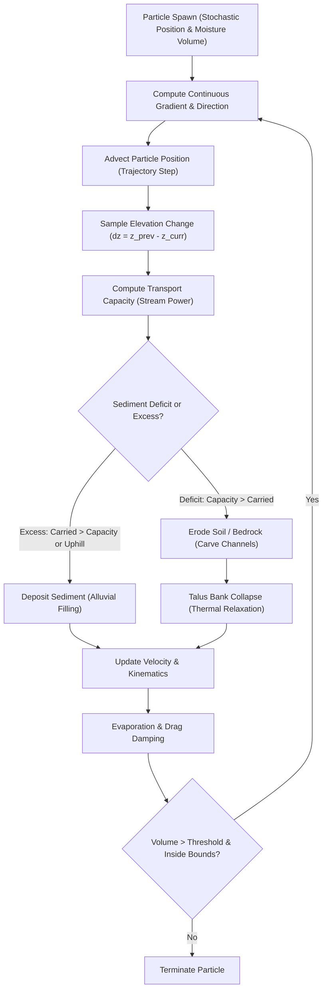
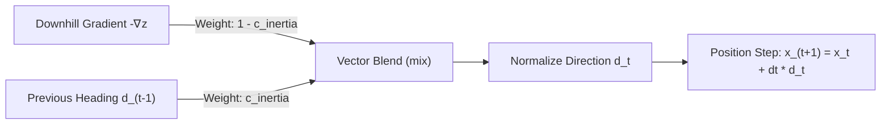
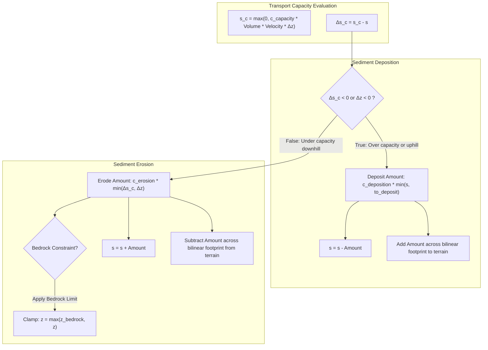
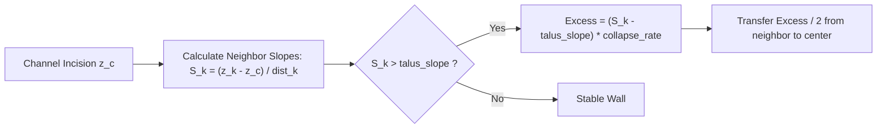
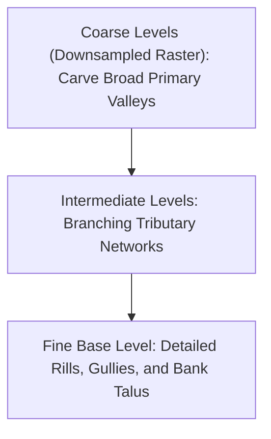

# Hydraulic Particle Erosion

This document details the simulation model, kinematics, sediment transport equations, and implementation of particle-based hydraulic erosion (`hydraulic_particle`) in HighMap.

## 1. Overview

Hydraulic erosion models the carving of terrain by surface water runoff. In HighMap, particle-based hydraulic erosion uses a Lagrangian formulation where virtual water droplets (particles) are spawned across the heightfield, navigate downslope according to local terrain kinematics, transport suspended sediment, and iteratively carve channels and deposit alluvial fans.





## 2. Particle Kinematics and Trajectories

### Surface Interpolation and Gradient Evaluation
Each particle is defined by a continuous 2D position $\mathbf{x} = (x, y) \in [0, N_x - 1] \times [0, N_y - 1]$. The integer grid coordinates $(i, j)$ and fractional offsets $(u, v)$ are given by:

$$i = \lfloor x \rfloor, \quad j = \lfloor y \rfloor, \quad u = x - i, \quad v = y - j$$

Elevation $z(\mathbf{x})$ is obtained through bilinear interpolation over the four enclosing heightfield vertices:

$$z(u, v) = (1 - u)(1 - v) z_{i, j} + u (1 - v) z_{i+1, j} + (1 - u) v z_{i, j+1} + u v z_{i+1, j+1}$$

The continuous terrain surface gradient $\nabla z = (g_x, g_y)$ is computed analytically across the cell:

$$g_x = (1 - v)(z_{i+1, j} - z_{i, j}) + v(z_{i+1, j+1} - z_{i, j+1})$$

$$g_y = (1 - u)(z_{i, j+1} - z_{i, j}) + u(z_{i+1, j+1} - z_{i+1, j})$$

### Trajectory Integration and Momentum Blending
The steepest downhill unit vector is $-\frac{\nabla z}{\|\nabla z\|}$. To simulate fluid momentum and prevent abrupt artificial turning, the particle's heading direction $\mathbf{d}_t$ blends the downhill gradient vector with its previous momentum direction $\mathbf{d}_{t-1}$ via inertia coefficient $c_{\text{inertia}} \in [0, 1]$:

$$\mathbf{d}_t = \mathrm{normalize}\left((1 - c_{\text{inertia}}) \left(-\frac{\nabla z}{\|\nabla z\|}\right) + c_{\text{inertia}} \, \mathbf{d}_{t-1}\right)$$



Across flat plateaus or local minima where $\|\nabla z\| \le \epsilon_{\text{slope}}$, momentum dominates ($c_{\text{eff}} = \max(c_{\text{inertia}}, 0.9)$), enabling particles to glide over shallow sills rather than stalling immediately.

Position integration advances the particle along its current heading:

$$\mathbf{x}_{t+1} = \mathbf{x}_t + \Delta t \, \mathbf{d}_t$$

### Velocity and Energy Conservation
As a droplet moves from elevation $z_{\text{prev}}$ to $z_{\text{curr}}$, the elevation difference $\Delta z = z_{\text{prev}} - z_{\text{curr}}$ drives acceleration or deceleration under gravity coefficient $g$:

$$v_{t+1} = \sqrt{\max\left(0, v_t^2 - \Delta z \cdot g_{\text{eff}}\right)}$$

For downhill movement ($\Delta z > 0$), kinetic energy increases. For uphill climbs ($\Delta z < 0$, e.g., inertia-driven movement across a local dip), gravitational deceleration applies. Kinetic friction dampens velocity each step:

$$v_{t+1} \leftarrow v_{t+1} \cdot (1 - \mu_{\text{drag}})$$

Volume decreases due to evaporation:

$$V_{t+1} = V_t \cdot (1 - \mu_{\text{evap}})$$

## 3. Sediment Transport Dynamics

At each step, the droplet carries an internal sediment load $s$. The maximum sediment capacity $s_c$ is governed by the stream power equation:

$$s_c = \max\left(0, c_{\text{capacity}} \cdot V \cdot v \cdot \Delta z\right)$$

The transport imbalance $\Delta s_c = \Delta t (s_c - s)$ determines whether erosion or deposition occurs.



### Deposition
When the particle slows down, reaches flatter slopes, or moves uphill ($\Delta s_c < 0$ or $\Delta z < 0$), it drops sediment:

$$\Delta s_{\text{drop}} = c_{\text{deposition}} \min(s, \text{to\_deposit})$$

$$s \leftarrow s - \Delta s_{\text{drop}}$$

The dropped sediment is distributed across the grid cell using bilinear weights:

$$w_{00} = (1 - u)(1 - v), \quad w_{10} = u(1 - v), \quad w_{01} = (1 - u)v, \quad w_{11} = uv$$

$$z_{i + \delta_i, j + \delta_j} \leftarrow z_{i + \delta_i, j + \delta_j} + w_{\delta_i, \delta_j} \Delta s_{\text{drop}}$$

### Erosion
When the flow is under-saturated ($\Delta s_c > 0$ and $\Delta z > 0$), material is carved from the surface:

$$\Delta s_{\text{lift}} = c_{\text{erosion}} \min(\Delta s_c, \Delta z)$$

$$s \leftarrow s + \Delta s_{\text{lift}}$$

Material is subtracted bilinearly from the surrounding vertices. When an optional bedrock map $z_{\text{bedrock}}$ is provided:
- Unconsolidated sediment (where $z > z_{\text{bedrock}}$) is eroded up to 4 times faster than bedrock.
- Subtraction is clamped to prevent digging below $z_{\text{bedrock}}$:

$$z_{i, j} \leftarrow \max(z_{\text{bedrock}, i, j}, z_{i, j})$$

## 4. Bank Collapse and Thermal Relaxation

Localized incision leaves steep vertical trench walls. To simulate natural valley widening and talus formation, bank collapse relaxes over-steepened slopes adjacent to carved cells:



For each of the 8 neighbors $k \in [0, 7]$ of cell $(i, j)$:

$$\text{slope}_k = \frac{z_k - z_c}{\text{dist}_k}$$

If $\text{slope}_k > \sigma_{\text{talus}}$, material collapses into the channel:

$$\Delta z_{\text{collapse}} = (\text{slope}_k - \sigma_{\text{talus}}) \cdot r_{\text{collapse}}$$

$$\Delta z_{\text{collapse}} \leftarrow \min\left(\Delta z_{\text{collapse}}, \max(0, z_k - z_{\text{bedrock}, k})\right)$$

$$z_k \leftarrow z_k - \frac{1}{2} \Delta z_{\text{collapse}}, \quad z_c \leftarrow z_c + \frac{1}{2} \Delta z_{\text{collapse}}$$

## 5. Multi-Pass and Multi-Scale Architectures

### Multi-Pass Iterations
Running all droplets in a single parallel OpenCL dispatch causes particles to ignore concurrent modifications made by peers. HighMap splits the particle budget into sequential iterations:

```text
nparticles = 500,000, iterations = 4
Pass 0: Dispatches 125,000 particles -> updates z
Pass 1: Dispatches 125,000 particles -> follows channels carved by Pass 0
Pass 2: Dispatches 125,000 particles -> further deepens drainage network
Pass 3: Dispatches 125,000 particles -> deposits alluvial sediment at outlets
```

Sequential passes allow tributaries to naturally converge into coherent dendritic river systems.

### Multi-Scale Cascade (`hydraulic_particle_multiscale`)
To form continental-scale valleys without millions of high-resolution particle steps, `hydraulic_particle_multiscale` downsamples the terrain into a multi-resolution pyramid:



1. The terrain is iteratively downsampled to coarse resolutions (e.g., $16\times, 8\times, 4\times, 2\times$).
2. Particle erosion runs on the coarse level to establish major trunk valleys and drainage divides.
3. The carved elevation deltas are upsampled and blended back into finer stages.
4. Final fine-resolution passes add micro-rills and rocky bank debris.

## 6. C++ API Reference

The primary interface resides in [`hydraulic_erosion.hpp`](file:///home/glop/Documents/dev/HighMap/HighMap/include/highmap/erosion/hydraulic_erosion.hpp):

```cpp
#include "highmap.hpp"

// Single-scale particle erosion
hmap::gpu::hydraulic_particle(
    z,                          // Target heightfield (in-place)
    nparticles,                 // Total droplet count (e.g. 0.5 * nx * ny)
    seed,                       // Random seed
    p_bedrock,                  // Optional bedrock constraint buffer
    p_moisture_map,             // Optional spatial spawn weight map
    p_elevation_shift,          // Optional transient elevation offset
    p_erosion_map,              // Optional output for total eroded material
    p_deposition_map,           // Optional output for total deposited sediment
    /* c_capacity */    10.0f,  // Sediment carrying capacity factor
    /* c_erosion */     0.05f,  // Erosion rate
    /* c_deposition */  0.05f,  // Deposition rate
    /* c_inertia */     0.01f,  // Directional momentum persistence [0, 1]
    /* c_gravity */     1.0f,   // Gravitational acceleration factor
    /* drag_rate */     0.001f, // Velocity damping per step
    /* evap_rate */     0.001f, // Evaporation per step
    /* talus_slope */   2.0f,   // Critical slope for bank collapse
    /* collapse_rate */ 0.10f,  // Bank collapse relaxation rate
    /* iterations */    4       // Multi-pass batch count
);
```
