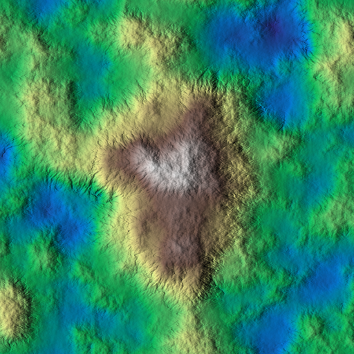
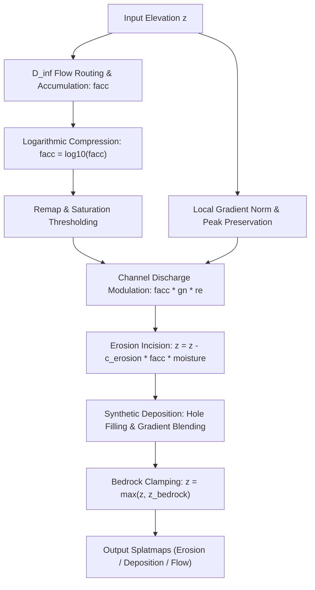
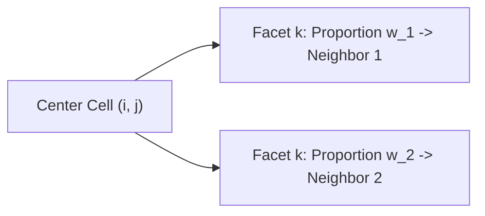
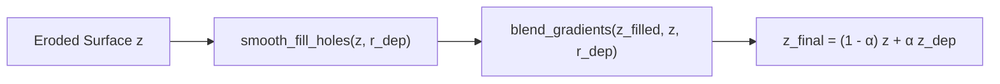
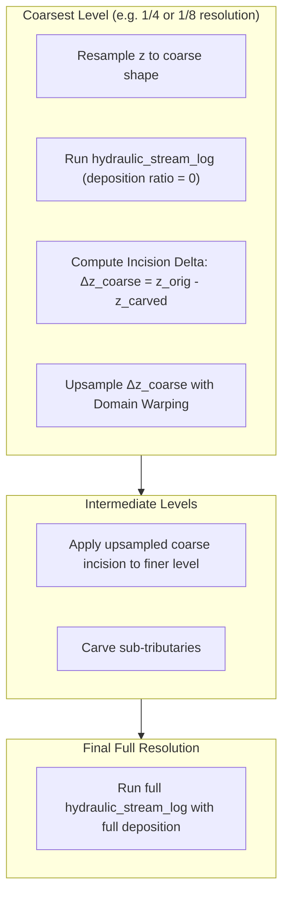

# Hydraulic Stream Log Erosion

This document details the algorithm, continuous flow formulation, logarithmic stream power scaling, and implementation of `hydraulic_stream_log` and `hydraulic_stream_log_multiscale` in HighMap.

## 1. Overview

While particle-based hydraulic erosion (`hydraulic_particle`) simulates discrete raindrops advecting across the surface, `hydraulic_stream_log` is an Eulerian, stream-power erosion model. It operates globally across the grid using continuous $D_\infty$ flow accumulation, logarithmic discharge scaling, local gradient modulation, and hole-filling deposition.



This method carves continuous, smooth dendritic river valleys and dendritic drainage basins rapidly across large terrains without Monte Carlo sampling noise.



## 2. Mathematical Model and Kinematics

### Continuous Flow Accumulation ($D_\infty$)
Water routing is computed using Tarboton's $D_\infty$ continuous flow direction model. Rather than confining flow to one of eight discrete directions ($D_8$), $D_\infty$ routes flow along triangular facets as a continuous facet angle $\theta \in [0, 2\pi)$.



The flow accumulation $A(x, y)$ represents the total upstream drainage area draining through cell $(x, y)$:

$$A_i = 1 + \sum_{j \in \text{inflow}(i)} w_{j \to i} A_j$$

where $w_{j \to i} \in [0, 1]$ is the fraction of cell $j$'s discharge directed toward cell $i$. Flow routing over flat regions or local depressions is stabilized using the reference slope parameter `talus_ref`.

### Logarithmic Compression
Because upstream area spans several orders of magnitude (from $10^0$ at ridges to $10^6+$ at primary river trunks), standard linear stream power causes catastrophic over-carving in main valleys while leaving feeder streams untouched.

`hydraulic_stream_log` applies base-10 logarithmic compression to the accumulated flow:

$$A_{\text{log}} = \log_{10}(A)$$

The compressed discharge is remapped to $[0, 1]$:

$$A_{\text{norm}} = \frac{A_{\text{log}} - \min(A_{\text{log}})}{\max(A_{\text{log}}) - \min(A_{\text{log}})}$$

If `saturation_ratio` $< 1.0$, upper river branches are saturated to broaden valleys:

$$A_{\text{sat}} = \mathrm{saturate}(A_{\text{norm}}, 0, s_{\text{ratio}}, 0.1 \cdot s_{\text{ratio}})$$

### Gradient Modulation and Stream Power
Stream power incision in nature depends on both discharge $Q$ and bed slope $S$:

$$E \propto Q^m S^n$$

HighMap models slope dependence by evaluating the smoothed surface gradient norm $\|\nabla z\|$:

1. Compute gradient norm $\|\nabla z\|$.
2. Smooth using compact pulse filtering (`smooth_cpulse`) with prefilter radius $r_{\text{grad}}$.
3. Raise to exponent $p = \text{gradient\_power}$ and apply a quintic smoothstep:

$$g_{\text{norm}} = S_5\left(\|\nabla z\|^p\right)$$

4. Modulate flow intensity with the gradient scaling ratio $r_{\text{scale}} \in [0, 1]$:

$$A_{\text{mod}} = A_{\text{sat}} \cdot \left((1 - r_{\text{scale}}) + r_{\text{scale}} \cdot g_{\text{norm}}\right)$$

### Ridge and Peak Preservation
To ensure that high peaks and sharp mountain ridges are not eroded away by accidental local flow initialization, relative elevation ($RE$) over a square kernel is sampled:

$$RE = \frac{z - \min_{\Omega}(z)}{\max_{\Omega}(z) - \min_{\Omega}(z)}$$

Valley bottoms have $RE \approx 0$, while sharp mountain ridges have $RE \approx 1$. Incision intensity is masked by the inverted cubic smoothstep of $RE$:

$$A_{\text{eff}} = A_{\text{mod}} \cdot S_3(1 - RE)$$

This focuses erosion strictly into valley troughs while preserving mountain crests and summits.

### Surface Incision
Elevation is carved according to erosion rate $c_{\text{erosion}}$ and optional moisture weighting $M(x, y)$:

$$z \leftarrow z - c_{\text{erosion}} \cdot M \cdot A_{\text{eff}}$$

## 3. Deposition Mechanics

Unlike physical Lagrangian transport where sediment is tracked along particle paths, Eulerian stream incision models lack explicit sediment load states. `hydraulic_stream_log` mimics alluvial fan deposition through morphological filtering and gradient blending:



1. **Hole Filling**: `gpu::smooth_fill_holes(z_d, deposition_ir)` eliminates artificial pit singularities and shallow micro-depressions created by intense carving.
2. **Gradient Blending**: `gpu::blend_gradients(z_d, z, deposition_ir)` blends the regional slope into the filled depressions.
3. **Linear Interpolation**: The surface blends with the deposition target using `deposition_scale_ratio` ($\alpha \in [0, 1]$):

$$z \leftarrow (1 - \alpha) z + \alpha z_d$$

4. **Bedrock Enforcement**: If a hard bedrock stratum $z_{\text{bedrock}}$ is provided, elevation is clamped from below:

$$z \leftarrow \max(z_{\text{bedrock}}, z)$$

## 4. Multiscale Architecture (`hydraulic_stream_log_multiscale`)

When creating expansive mountain landscapes, applying flow accumulation at a single high resolution can produce overly fine, dense rill networks rather than majestic, wide valley corridors.

`hydraulic_stream_log_multiscale` solves this by building an octave downsampling pyramid:



### Multiscale Algorithm Steps
1. **Pyramid Ladder**: Generates $L$ power-of-two resolutions $\text{ladder}[i]$ for $i = 0, \ldots, L - 1$, from coarsest to full resolution.
2. **Coarse Scale Carving**:
   - The terrain is downsampled to `ladder[i]`.
   - `hydraulic_stream_log` runs on the coarse grid to identify primary macro-valleys.
   - The incision delta $\Delta z_{\text{coarse}} = z_{\text{before}} - z_{\text{after}}$ is calculated.
3. **Domain-Warped Upsampling**:
   - $\Delta z_{\text{coarse}}$ is upsampled smoothly back to full resolution.
   - Procedural Perlin domain warping (`warp`) perturbs the upsampled delta, preventing geometric blockiness and introducing natural organic meanders into the valley paths.
   - The scaled incision $\text{mix} \cdot \Delta z_{\text{warped}}$ is subtracted from the full-resolution terrain.
4. **Fine Scale Detail**:
   - The finest level runs with `deposition_scale_ratio` active, producing detailed riverbanks, braided streams, and sediment flats.

## 5. C++ API Reference

The functions are declared in [`hydraulic_erosion.hpp`](file:///home/glop/Documents/dev/HighMap/HighMap/include/highmap/erosion/hydraulic_erosion.hpp):

```cpp
#include "highmap.hpp"

// Single-scale logarithmic stream erosion
hmap::gpu::hydraulic_stream_log(
    z,                              // Target heightfield
    /* c_erosion */              0.2f,
    /* talus_ref */              5.0f / shape.x,
    /* deposition_ir */          32,
    /* deposition_scale_ratio */ 1.0f,
    /* gradient_power */         0.8f,
    /* gradient_scaling_ratio */ 1.0f,
    /* gradient_prefilter_ir */  16,
    /* saturation_ratio */       1.0f,
    /* p_bedrock */              nullptr,
    /* p_moisture_map */         nullptr,
    /* p_erosion_map */          nullptr,
    /* p_deposition_map */       nullptr,
    /* p_flow_map */             nullptr
);

// Multiscale logarithmic stream cascade
hmap::gpu::hydraulic_stream_log_multiscale(
    z,                              // Target heightfield
    /* c_erosion */              0.2f,
    /* talus_ref */              5.0f / shape.x,
    /* levels */                 3,
    /* deposition_ir */          32,
    /* deposition_scale_ratio */ 1.0f,
    /* gradient_power */         0.8f,
    /* gradient_scaling_ratio */ 1.0f,
    /* gradient_prefilter_ir */  16,
    /* saturation_ratio */       1.0f,
    /* p_bedrock */              nullptr,
    /* p_moisture_map */         nullptr,
    /* p_erosion_map */          nullptr,
    /* p_deposition_map */       nullptr,
    /* p_flow_map */             nullptr,
    /* mix */                    1.0f,
    /* warp */                   0.35f,
    /* seed */                   1
);
```
