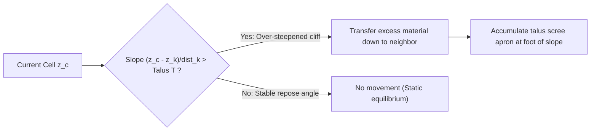
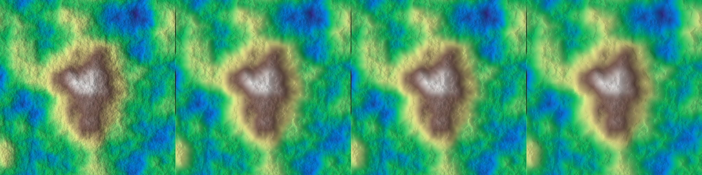
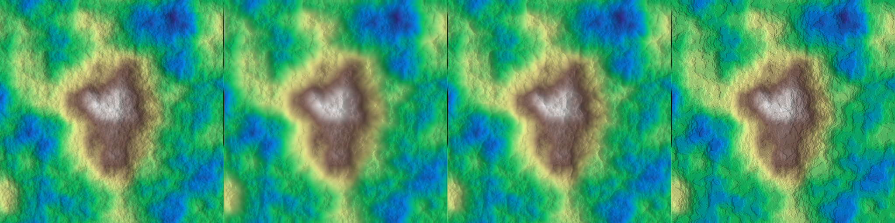
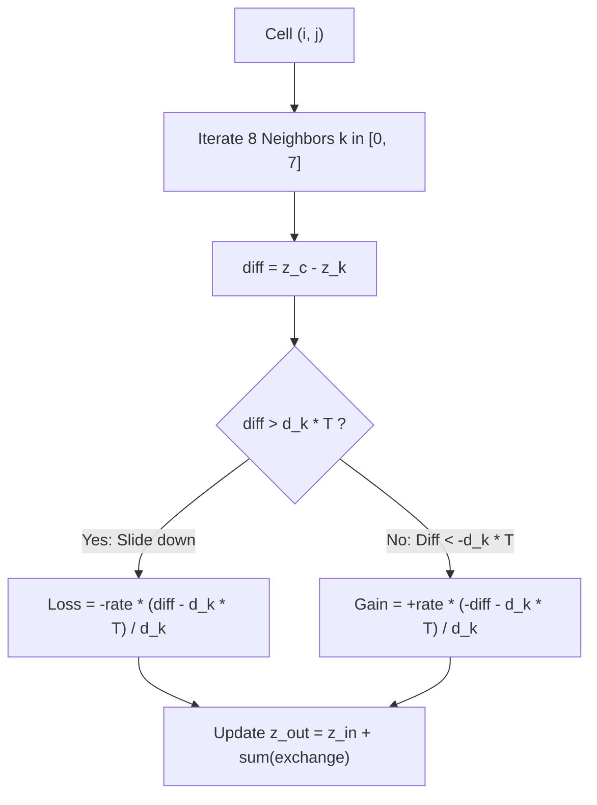

# Thermal Weathering and Talus Erosion Algorithms

This document provides a comprehensive overview of the thermal erosion models implemented in HighMap. Thermal weathering simulates mechanical rock disintegration (freeze-thaw fracturing, gravity-induced scree slides, and scarp retreat) where material collapses when slopes exceed the critical angle of repose (talus slope).

All GPU algorithms are accelerated via OpenCL and defined in [`thermal_erosion.hpp`](file:///home/glop/Documents/dev/HighMap/HighMap/include/highmap/erosion/thermal_erosion.hpp).

## 1. Physical Foundations

Thermal erosion describes the diffusion of granular matter down steep terrain gradients under gravity. For each grid cell $\mathbf{x} = (x, y)$ and neighbor $\mathbf{x}_k$:

$$\Delta z_k = z(\mathbf{x}) - z(\mathbf{x}_k), \quad S_k = \frac{\Delta z_k}{d_k}$$

where $d_k \in \{1, \sqrt{2}\}$ is grid spacing across the 8-neighborhood ($D_8$). Material slides down when the slope $S_k$ exceeds the critical talus angle of repose $T$:

$$S_k > T \implies \Delta V_k \propto (S_k - T)$$



## 2. Visual Comparison

The banner below compares the original un-eroded rugged terrain with the different thermal algorithms evaluated under identical talus conditions ($T = 2.5 / N_x$):

### Standard, Conserving, and Schott Models


*Left to right: (1) Original un-eroded terrain, (2) `thermal` (standard exchange), (3) `thermal_conserve` (mass-preserving), (4) `thermal_schott` (uniform slope count).*

### Olsen, Ridge, and Flatten Models


*Left to right: (1) Original un-eroded terrain, (2) `thermal_olsen` (strictly bounded redistribution), (3) `thermal_ridge` (crests sharpened), (4) `thermal_flatten` (asymmetric slope relaxation).*

## 3. Algorithm Details and Equations

### 1. Standard Thermal Weathering (`thermal`)
Based on cellular automaton material exchange across the 8-connected neighborhood.



The exchange function between cell $z_c$ and neighbor $z_k$ at distance $d_k$ is:

$$\delta z_k = \begin{cases} -r \cdot \frac{(z_c - z_k) - d_k T}{d_k} & \text{if } z_c - z_k > d_k T \\ +r \cdot \frac{(z_k - z_c) - d_k T}{d_k} & \text{if } z_k - z_c > d_k T \\ 0 & \text{otherwise} \end{cases}$$

with default relaxation rate $r = 0.2$.

### 2. Mass-Preserving Thermal Erosion (`thermal_conserve`)
Standard local relaxation can introduce numerical volume drift due to concurrent neighbor exchanges. `thermal_conserve` preserves total mass by computing normalized outgoing fluxes:

1. Identify all downhill neighbors with excess slope:

$$E_k = \max\left(0, \frac{z_c - z_k}{d_k} - T\right)$$

2. Compute total excess slope sum: $\Sigma_E = \sum_k E_k$.
3. Distribute available material proportionally so total volume leaving the cell matches total incoming volume at neighbors:

$$\Delta z_{k \to \text{dest}} = \frac{r}{2} \cdot \frac{E_k}{\Sigma_E} \cdot \max_j(E_j)$$

### 3. Schott Model (`thermal_schott`)
The Schott formulation discretizes thermal erosion into uniform step shifts based on neighbor slope voting:

$$\text{down} = \sum_{k=0}^7 \mathbb{I}\left(\frac{z_c - z_k}{d_k} > T\right), \quad \text{up} = \sum_{k=0}^7 \mathbb{I}\left(\frac{z_c - z_k}{d_k} < -T\right)$$

$$z_{\text{next}} = z_c + \lambda \cdot T \cdot (\text{up} - \text{down})$$

where $\lambda$ is the `intensity` factor (typically $0.1 - 0.25$). This yields crisp cliff faces with uniform talus slopes at their base.

### 4. Olsen Redistribution Model (`thermal_olsen`)
The Olsen model calculates exact sediment transfers based on the maximum excess slope:

1. For cell $c$, calculate $\Delta z_{\max} = \max_k (z_c - z_k - d_k T)$ and $\Delta z_{\text{sum}} = \sum_k (z_c - z_k)$.
2. The material removed from $c$ to neighbor $k$ is:

$$\Delta z_k = \frac{1}{4} (\Delta z_{\max} - d_k T) \frac{z_c - z_k}{\Delta z_{\text{sum}}}$$

3. In a complementary pass, incoming deposits from uphill cells are added to $z_c$. This creates smooth talus aprons with bounded maximum slopes.

### 5. Thermal Ridge (`thermal_ridge`)
`thermal_ridge` sharpens mountain crests while flattening scree fields. It modulates the elevation adjustment using maximum local slope:

$$S_{\max} = \max_k \left|\frac{z_c - z_k}{d_k}\right|$$

$$A_{\text{amp}} = S_3\left(\mathrm{clamp}\left(1 - \frac{T}{S_{\max}}, 0, 1\right)\right)$$

$$z_{\text{next}} = z_c + \frac{1}{4} \left(T - \frac{1}{2} \sum_{k, \Delta z_k > 0} \frac{\Delta z_k}{d_k}\right) \cdot A_{\text{amp}}$$

where $S_3(x) = 3x^2 - 2x^3$ is the smoothstep function. Steep peaks maintain razor ridges, while lower slopes diffuse outward.

### 6. Thermal Flatten (`thermal_flatten`)
`thermal_flatten` introduces asymmetric slope relaxation using dual thresholds $\sigma_{\text{inf}}$ and $\sigma_{\text{sup}}$:

- When steepest slope $S_{\max} < T$: relaxed at rate $\sigma_{\text{inf}}$ (planar smoothing of shallow flats and valleys).
- When steepest slope $S_{\max} > T$: relaxed at rate $\sigma_{\text{sup}}$ (diffusion of steep cliff faces).

Setting $\sigma_{\text{sup}} = 0$ while keeping $\sigma_{\text{inf}} > 0$ levels flat plateaus and valley basins while leaving rocky spires completely untouched.

### 7. Bedrock Constraints (`thermal_auto_bedrock`)
All thermal models support optional bedrock constraints ($z_{\text{bedrock}}$):

$$z_{\text{next}} \leftarrow \max(z_{\text{bedrock}}, z_{\text{next}})$$

With `thermal_auto_bedrock`, bedrock elevation is derived automatically from the local morphological minimum of the initial terrain, ensuring that erosion exposes rocky cliffs where soil has sloughed off into valleys.

## 4. Model Selection Matrix

| Function | Primary Visual Effect | Conserves Mass | Best Used For |
| :--- | :--- | :---: | :--- |
| `thermal` | Natural talus accumulation | Approximate | General-purpose gravel and scree diffusion |
| `thermal_conserve` | Strictly bounded sediment mass | Yes | Physically based talus accumulation without volume loss |
| `thermal_schott` | Uniform stepped cliffs and benches | No | Blocky canyon steps, sandstone cliffs, stratified walls |
| `thermal_olsen` | Realistic alluvial fan profiles | Yes | High-precision geological scree deposition |
| `thermal_ridge` | Sharp razor crests and talus bases | No | Alpine peaks, glacial arêtes, dramatized ridges |
| `thermal_flatten` | Asymmetric plateau/flat smoothing | No | Mesas, plateaus, terrace leveling without altering cliffs |
| `thermal_rib` | Carves acute micro-flutes on slopes | No | Badlands rills, organ-pipe fluting, weathered rock ribs |

## 5. C++ API Reference

```cpp
#include "highmap.hpp"

// Setup terrain and per-cell talus map
hmap::Array z = ...;
float talus_val = 2.5f / static_cast<float>(z.shape.x);
hmap::Array talus = hmap::constant(z.shape, talus_val);
int iterations = 30;

// Standard thermal
hmap::gpu::thermal(z, talus, iterations);

// Mass-conserving thermal
hmap::gpu::thermal_conserve(z, talus, iterations, /* rate */ 0.5f);

// Schott model
hmap::gpu::thermal_schott(z, talus, iterations, /* intensity */ 0.2f);

// Olsen model
hmap::gpu::thermal_olsen(z, talus, iterations);

// Thermal ridge sharpening
hmap::gpu::thermal_ridge(z, talus, iterations);

// Asymmetric flattening (smooth flats below talus)
hmap::gpu::thermal_flatten(z, talus, iterations, /* sigma_inf */ 0.5f, /* sigma_sup */ 0.0f);
```
