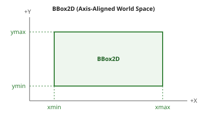
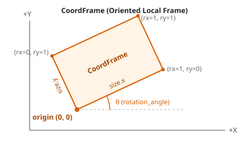

# Core Concepts

This page describes the primary data structures and representations used in HighMap.

## 1. Elevation Representations

HighMap provides three main structures for 2D height data:

| Structure | Type | Description |
| :--- | :--- | :--- |
| `Array` | `hmap::Array` | In-memory 2D array of floats with contiguous storage. |
| `HeightMap` | `hmap::HeightMap` | Tiled 2D array designed for parallel computation. |
| `VirtualArray` | `hmap::VirtualArray` | Tiled structure supporting disk and RAM storage for large grids. |

### Array

`Array` is the basic container for 2D elevation fields. Data is stored in row-major order. It supports arithmetic operators, statistical queries, slicing, and filtering.

```cpp
hmap::Array z({512, 512});
z = 1.0f;
float val = z(i, j);
```

## 2. Bivariate Functions

Continuous functions deriving from `hmap::Function` represent mathematical surfaces $f(x, y)$ independently of resolution:

- `hmap::NoiseFunction`: Perlin, Simplex, and cellular noise generators.
- `hmap::FbmFunction`: Multi-octave fractal noise.
- `hmap::FieldFunction`: Distance fields and geometric functions.

## 3. Geometric Primitives

Geometric entities represent vector features and integrate with height arrays:

- `hmap::Point` / `hmap::Cloud`: Individual points and point clouds.
- `hmap::Edge` / `hmap::Path`: Segments and ordered sequences of points.
- `hmap::Graph`: Node and edge graphs used for networks such as rivers and roads.

## 4. Talus vs. Slope

When simulating erosion or analyzing terrain gradients, HighMap distinguishes between **talus** and **slope**:

### Talus (Grid-Space Elevation Difference)
In HighMap, the **talus** is defined as the direct elevation difference between neighboring grid cells (or the critical vertical threshold per grid step):

$$\text{talus} = \Delta z = z_{i+1, j} - z_{i, j}$$

- **Resolution dependent**: For a given physical terrain gradient, increasing the grid resolution $N_x \times N_y$ places adjacent cell centers closer together, decreasing the elevation step $\Delta z$ between neighbors. Consequently, threshold talus parameters scale inversely with grid resolution (e.g., $\text{talus} \propto 1 / N_x$).
- **Domain size independent**: Talus operates entirely in discrete grid space ($i, j$) and does not depend on the physical world-space dimensions of the terrain domain.

### Slope (Metric Surface Gradient)
The **slope** is the metric rate of change of elevation with respect to physical horizontal distance in the terrain domain:

$$\text{slope} = \frac{\Delta z}{\Delta x} = \frac{z(\mathbf{x}_2) - z(\mathbf{x}_1)}{\|\mathbf{x}_2 - \mathbf{x}_1\|}$$

where $\Delta x = L_x / N_x$ represents the physical cell spacing for a domain of size $L_x$.

- **Domain size dependent**: Slope depends on physical metric units (such as meters or kilometers) and the overall domain extent $L_x \times L_y$.
- **Resolution independent**: As grid resolution increases ($N_x \to \infty$), the ratio $\Delta z / \Delta x$ converges toward the continuous spatial derivative $\|\nabla z\|$, maintaining an invariant physical slope regardless of raster resolution.

### Relationship: talus = slope / nx
In unit-box normalized domains ($L_x = 1$), the physical cell spacing is $\Delta x = 1 / N_x$. Substituting $\Delta x$ into the slope definition yields:

$$\text{slope} = \frac{\Delta z}{\Delta x} = \frac{\text{talus}}{1 / N_x} = \text{talus} \cdot N_x$$

Rearranging for the grid-cell talus threshold gives:

$$\text{talus} = \frac{\text{slope}}{N_x}$$

This identity is why erosion parameters throughout HighMap are specified by dividing a reference slope by the grid dimension:

```cpp
// Set a critical slope of 2.5 across an Nx grid
float talus = 2.5f / static_cast<float>(shape.x);
```

```text
Grid step:           [ Cell i ] -------- Δx = 1/Nx -------- [ Cell i+1 ]
                              \                               /
                               \                             /
Elevation drop:                 \----- Δz (talus) ----------/

Talus:  Δz = slope / Nx      (height drop per grid cell; depends on resolution)
Slope:  Δz / Δx              (physical grade; depends on domain extent L_x)
```

## 5. Scattering

The scattering system handles the distribution of discrete objects over a terrain:

- `hmap::ScatterItem`: Basic element storing a 3D position, an integer class identifier, and a radius.
- `hmap::ScatterField`: Container providing spatial operations (collision pruning, density maps, elevation projection).
- `hmap::Forest`: Scattering container for vegetation and growth models.
- `hmap::RockField`: Scattering container for rock and debris placement.

## 6. Spatial Coordinates: UV, BBox, and CoordFrame

HighMap distinguishes three complementary 2D spatial representations depending on whether coordinates are normalized, axis-aligned in world space, or oriented:

| Concept | Type | Coordinate Space | Rotation | Primary Use |
| :--- | :--- | :--- | :--- | :--- |
| **UV** | `hmap::UvRect` | Normalized $[0, 1]^2$ | No | Tiling (`VirtualArray`, `VirtualTexture`), texture/UV slicing |
| **BBox** | `hmap::BBox2D` | World / domain space | No | Axis-aligned bounds (`Cloud`, `Path`, `Graph`, function domains) |
| **CoordFrame** | `hmap::CoordFrame` | World + local $[0, 1]^2$ | Yes | Oriented regions, stamps, and local-to-global transforms |

### UV (`[0, 1]^2` Normalized Domain)

UV coordinates $(u, v) \in [0, 1]^2$ represent a normalized, resolution-independent unit square. `VirtualArray` and `VirtualTexture` canonically span $[0, 1]^2$ in UV space, and each tile carries its own `UvRect` slice.

![UV Space [0, 1]^2](../../images/spatial_uv.svg)

### BBox (`BBox2D` Axis-Aligned Bounding Box)

A bounding box defines an axis-aligned rectangular region in world or domain coordinates using `(xmin, xmax, ymin, ymax)`. It is used for spatial extents of geometric primitives (`Cloud`, `Path`, `Graph`), evaluation domains, and fast overlap checks.



### CoordFrame (`CoordFrame` Oriented Local Frame)

`hmap::CoordFrame` defines an oriented 2D coordinate frame with an `origin`, `size`, and `rotation_angle`. It maps between local unit coordinates $(r_x, r_y) \in [0, 1]^2$ (`map_to_global_coords`) and global world coordinates $(g_x, g_y)$ (`map_to_relative_coords`), and can compute its enclosing axis-aligned bounding box via `compute_bounding_box()`.


